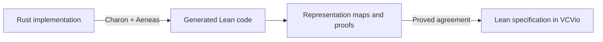

# Bridging Rust implementations to Lean specifications

How do we connect a cryptographic specification to the code that implements it?
This project explores that question through small, worked examples in Rust and Lean 4.
It supports the [Signal Shot](https://github.com/Beneficial-AI-Foundation/signal-shot)
project's longer-term goal of formally verifying libsignal.

We start with simple examples so that the connection between code and specification is easy
to follow. ML-KEM and erasure coding motivated this work, but their complexity made them less
suitable as starting points. The examples here use generic callbacks and mutable state,
introducing patterns relevant to Rust cryptographic libraries without requiring a large codebase.

## What is bridging?

[Aeneas](https://github.com/AeneasVerif/aeneas) translates Rust programs into Lean definitions.
Its frontend, Charon, first extracts an intermediate representation of the Rust code.
Separately, [VCVio](https://github.com/Verified-zkEVM/VCVio) provides a language for expressing
cryptographic algorithms and reasoning about their behavior in Lean.

Having both in Lean does not automatically connect them. The implementation might use bytes,
structs, and mutable state, while the specification uses mathematical values and oracle queries.
We write **representation maps** to relate these values, then prove that the extracted operations
agree with the specification. That is the bridge.



Extraction generates the implementation's Lean definitions. The representation maps and proofs
are written by us. They account for returned values, changes to state, and failure behavior.

## The examples

### Commitment: connecting an implementation to a specification

A commitment lets someone commit to a message and reveal it later. Our small Rust implementation
combines a message with a salt obtained from an RNG, passes both to a hash callback, and returns
the digest together with an opening. Verification recomputes the digest from the opening.

The bridge connects these operations to VCVio's existing `CMCommit` and `CMCheck` definitions.
It maps Rust bytes to mathematical bytes and the opening to a message–salt pair. An explicit
contract describes how the hash callback corresponds to the specification's oracle.

We prove that both operations agree with the specification under that contract. When the hash
always succeeds and represents one fixed function, committing and then verifying returns `true`
after a successful RNG draw, with the correct final RNG state. Failed or divergent RNG calls
remain visible in the result.

This establishes conditional correctness. It does not yet prove that a concrete hash satisfies
the contract, that salts are random, or that the scheme hides messages and prevents conflicting
openings. The byte-sized example and its deliberately insecure test hash are educational.

Read the [Rust code](rust/commitment/src/lib.rs), its
[generated Lean translation](Generated/Commitment/Funs.lean), and the
[bridge proofs](BridgingExamples/Commitment/Bridge.lean).

### Lazy and eager sampling: connecting stateful code to a probability model

The second Rust example implements a tiny oracle with two possible keys. On the first query to
a key, it obtains a byte from an RNG and caches it. Repeated queries return the cached answer.

We first prove that the extracted code agrees with VCVio's cache model. We then initialize a
simple RNG fixture with two independent uniform bytes and prove that clients observe the same
output distribution as if the entire answer table had been sampled in advance. This remains
true when a client chooses later queries based on earlier answers.

The proof must track both the cache and the unused random bytes. Uniform initialization is part
of the Lean experiment; we do not claim that an operating-system RNG realizes that experiment.

Read the [Rust code](rust/lazy-oracle/src/lib.rs), the
[deterministic bridge](BridgingExamples/LazyOracle/Bridge.lean), and the
[probability proof](BridgingExamples/LazyOracle/ProbabilityBridge.lean).

For an even smaller introduction, the [byte-identity example](BridgingExamples/Smoke.lean)
shows the complete path from an extracted function to a simple mathematical specification.

## Installation

Install [Lean through elan](https://lean-lang.org/install/manual/), along with Git and curl.
The repository selects its Lean version automatically. To check the existing proofs, run these
commands from the project directory in a Bash terminal:

```bash
LEAN_NUM_THREADS=4 nice -n 19 lake exe cache get
LEAN_NUM_THREADS=4 nice -n 19 lake build
```

The generated Lean files are included, so this does not require Rust or the extraction tools.
Lean supports Linux, macOS, and Windows; in a native Windows shell, set `LEAN_NUM_THREADS` to `4`
and run the Lake commands without the Unix `nice` wrapper. This project has been validated
end to end on Linux x86_64; other platforms still need validation.

If you also want to extract the Rust examples yourself, you will need Bash, Python 3, a C
compiler/linker, and the usual archive utilities. The setup script installs the pinned Rust,
Charon, and Aeneas tools locally:

```bash
bash scripts/setup-tools.sh
bash scripts/check.sh
```

Setup selects binaries for Linux x86_64, Linux ARM64, or Apple Silicon macOS. Windows users can
run it inside [WSL2](https://learn.microsoft.com/en-us/windows/wsl/install); Intel Mac users need
a supported Linux environment for extraction. On macOS, install Xcode Command Line Tools first.
The first run downloads dependencies. `check.sh` re-extracts the small byte-identity example and
checks all Lean proofs; the individual extraction scripts are in [scripts/](scripts/).

## Finding your way around

The code follows the same progression as the diagram: [rust/](rust/) contains the implementations
and tests, [Generated/](Generated/) contains Aeneas output, and
[BridgingExamples/](BridgingExamples/) contains the handwritten bridges and proofs.
Generated files should be regenerated rather than edited. Dependency versions are fixed in
[lake-manifest.json](lake-manifest.json) and the setup scripts.

The proofs contain no admissions or new axioms. The `TrustAudit.lean` files report their axiom
dependencies during the build. Some imported Aeneas lemmas emit existing admission warnings,
but those admissions are absent from the audited bridge proofs. The verification still relies
on Lean's kernel and on the Rust-to-Lean translation being faithful.

These examples demonstrate a verification method. They do not yet verify libsignal or provide
production cryptographic implementations.
